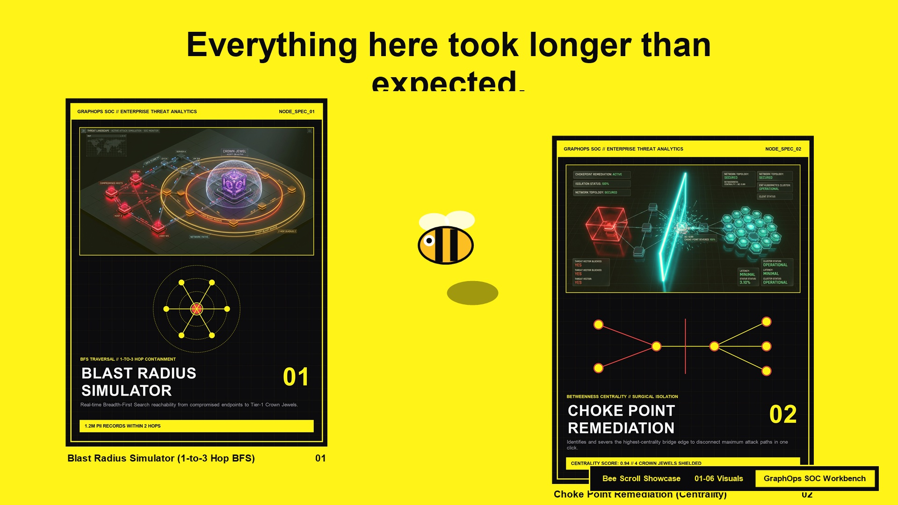
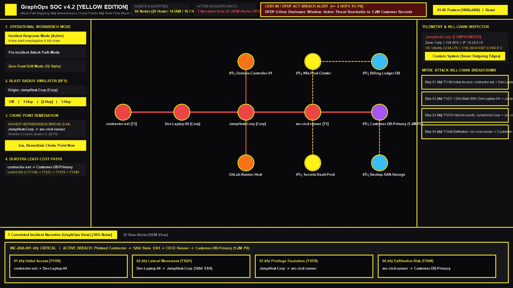
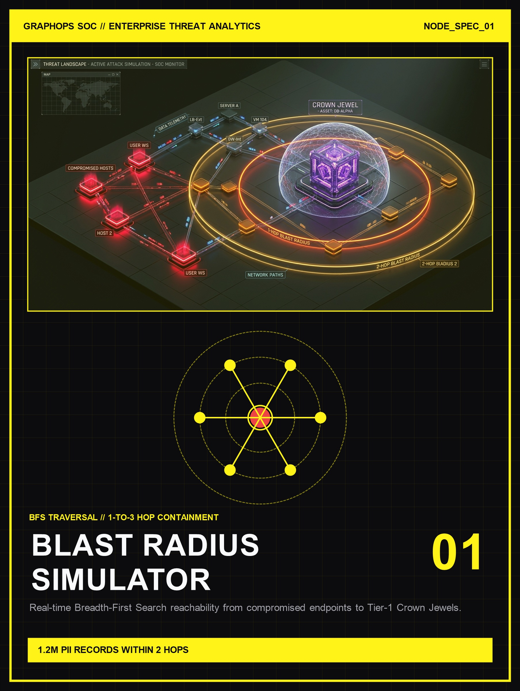
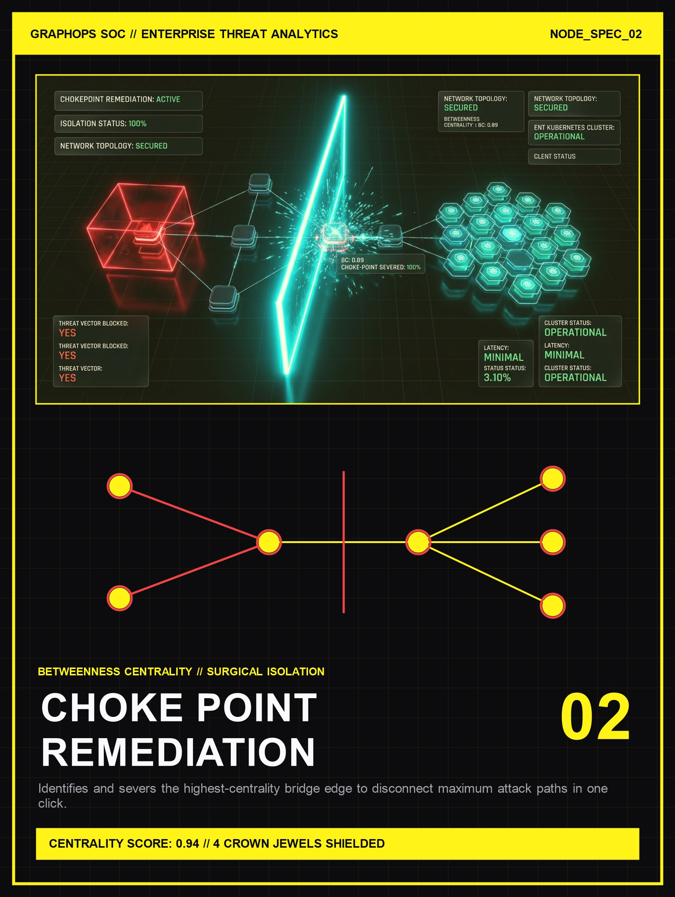
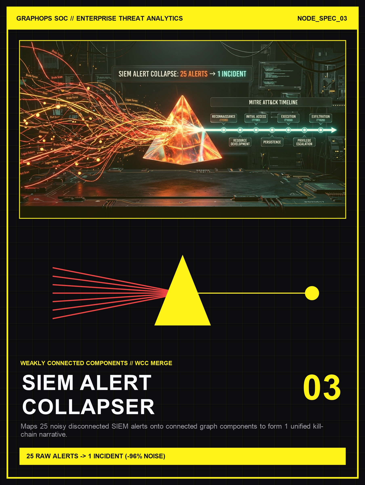
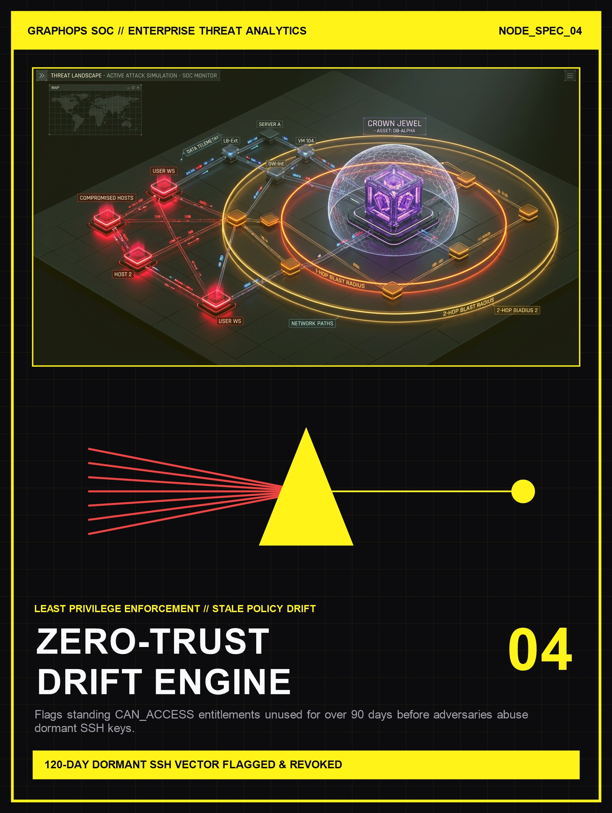
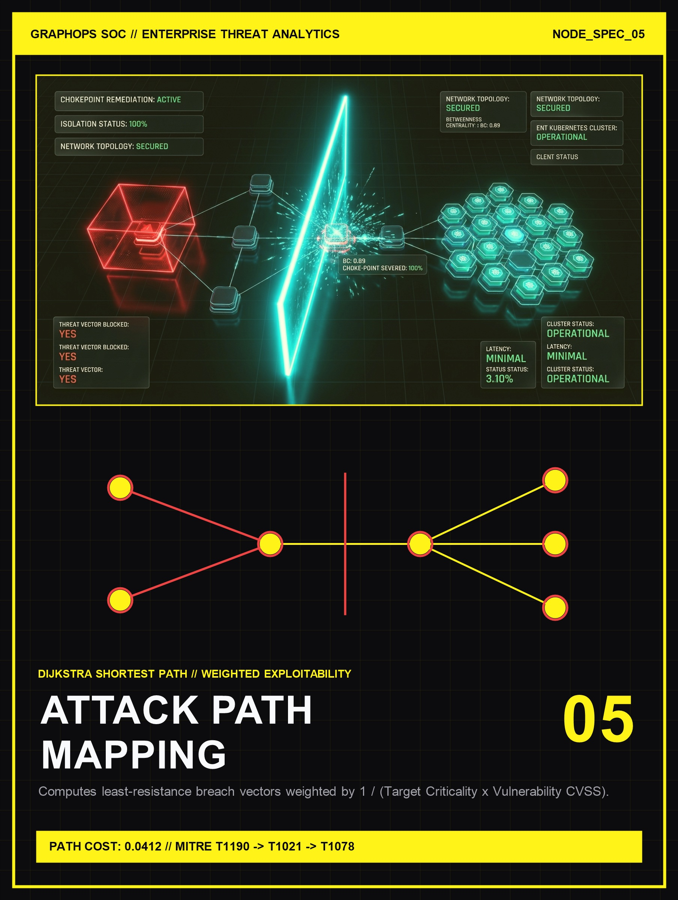
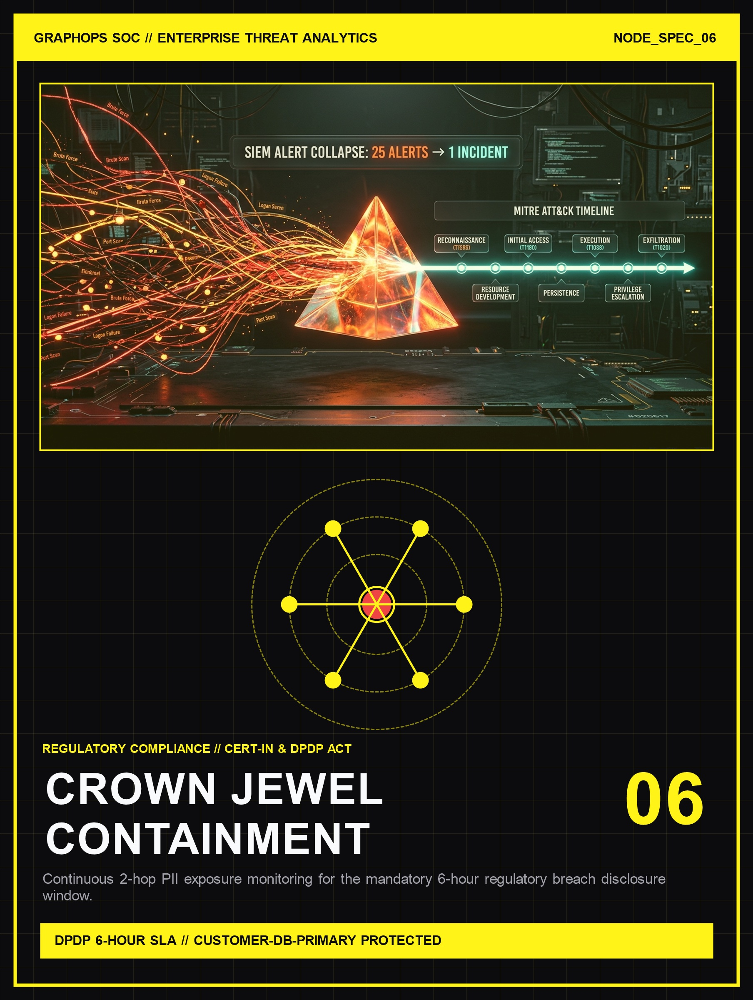
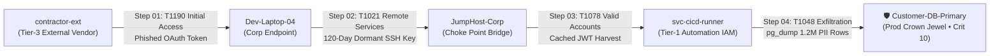

# ⚡ GraphOps Omen — Security Operations Center (SOC) Workbench & Scroll Experience

<p align="center">
  
</p>

<p align="center">
  
</p>

---

## 🎯 Overview

**GraphOps Omen** combines an interactive **GSAP + Lenis + Lottie scroll-driven editorial showcase** (styled in the signature `#fff318` Yellow & Obsidian Black theme) with a full, production-grade **Cybersecurity Graph Analytics & SOC Analyst Workbench**.

Traditional SIEM platforms overwhelm analysts with thousands of disconnected, flat table alerts. **GraphOps** solves the alert-fatigue problem by modeling enterprise infrastructure as a connected graph—merging raw alerts into unified MITRE ATT&CK kill-chain narratives, calculating real-time **1-to-3 hop blast radiuses**, pinpointing critical **Betweenness Centrality choke points**, and flagging **Zero-Trust entitlement drift**.

---

## 🖼️ Generated `1808×2400` Editorial Threat Posters (Yellow Edition)

All six spotlight cards in the scroll showcase feature bespoke `1808×2400` vertical editorial posters matching the `#fff318` yellow & obsidian theme:

| `01` Blast Radius Simulator | `02` Choke Point Remediation | `03` SIEM Alert Collapser |
| :---: | :---: | :---: |
|  |  |  |
| **1-to-3 Hop BFS Traversal** | **Betweenness Centrality Isolation** | **WCC Alert Correlation (-96% Noise)** |

| `04` Zero-Trust Drift Engine | `05` Dijkstra Attack Path Mapping | `06` DPDP 6-Hour Crown Jewel Vault |
| :---: | :---: | :---: |
|  |  |  |
| **>90-Day Stale Privilege Revocation** | **Weighted Least-Cost Pathing** | **CERT-In & DPDP Compliance Guard** |

---

## 🧠 Core Architecture & In-Browser Graph Algorithms

Implemented in [`src/utils/graphAlgorithms.ts`](./src/utils/graphAlgorithms.ts) over a pre-populated **44-node synthetic enterprise topology** ([`src/data/mockTopology.ts`](./src/data/mockTopology.ts)):

1. **Breadth-First Search (BFS) Blast Radius (`calculateBlastRadius`)**
   - Computes `1-Hop` (Orange `#F97316`), `2-Hop` (Amber/Yellow `#FBBF24`), and `3-Hop` (Slate Blue `#38BDF8`) lateral reachability from any selected or compromised node.
   - Dynamically counts exposed Crown Jewels and regulated PII records (`1.2M` customer records on `Customer-DB-Primary`).

2. **Dijkstra's Shortest Attack Paths (`findShortestAttackPaths`)**
   - Calculates least-resistance breach vectors from external/compromised entry points to Crown Jewels using weighted edges:
     $$\text{Weight} = \frac{1}{\text{target.criticality} \times \text{target.vuln\_cvss}}$$

3. **Betweenness Centrality Choke Point Calculation (`calculateChokePoints`)**
   - Evaluates all shortest attack paths to identify the top 3 bridge nodes and edges (`JumpHost-Corp → svc-cicd-runner`).
   - Provides a one-click **"Remediate Choke Point Now"** action that dynamically severs the bridge edge in real time and shields downstream Crown Jewels.

4. **Weakly Connected Components (WCC) SIEM Alert Collapser (`mergeAlerts`)**
   - Maps **25 noisy raw SIEM alerts** (port scans, failed VPN OTPs, Kerberos skew, and multi-stage breach events) onto connected graph components, collapsing them into **1 unified MITRE ATT&CK incident narrative** (**96% alert noise reduction**).

---

## 🚨 Pre-Injected Multi-Hop Breach Scenario



- **CERT-In / India DPDP Act 6-Hour Disclosure Window Alert**: Whenever any node with `pii_data: true` is reachable within $\le 2$ hops of a compromised node, the Top KPI Bar triggers a pulsing regulatory alert banner (`DPDP 6-Hour Disclosure Window: Active Threat Reachable to 1.2M Customer Records`). Severing the choke point or containing `JumpHost-Corp` immediately transitions the workbench into a compliant **Contained** state.

---

## 🛠️ Tech Stack

- **Frontend Workbench**: React 19, TypeScript, Tailwind CSS v4, Vite 8
- **Graph Visualization Engine**: Cytoscape.js with `cytoscape-dagre` (hierarchical attack trees), `cytoscape-cola` (force-directed physics), and concentric criticality ring layouts
- **Scroll Animation Showcase**: GSAP (`ScrollTrigger`), Lenis Smooth Scroll, `lottie-web` dual SVG renderer (`bee.json`)
- **Icons**: Lucide React

---

## 🚀 Getting Started Locally

```bash
# 1. Install dependencies
npm install

# 2. Start the Vite development server
npm run dev

# 3. Build for production (Vercel)
npm run build
```

---

## ▲ Deploying to Vercel

This repository is pre-configured with [`vercel.json`](./vercel.json) for zero-configuration deployment on Vercel:
1. Import `https://github.com/FakerFAME/GraphOps-Omen-.git` in your Vercel Dashboard.
2. Vercel automatically detects **Vite**, runs `npm run build`, and serves the `dist/` output directory.
